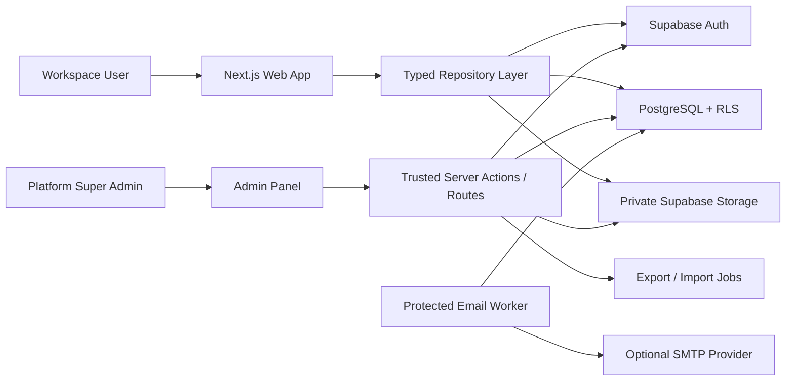
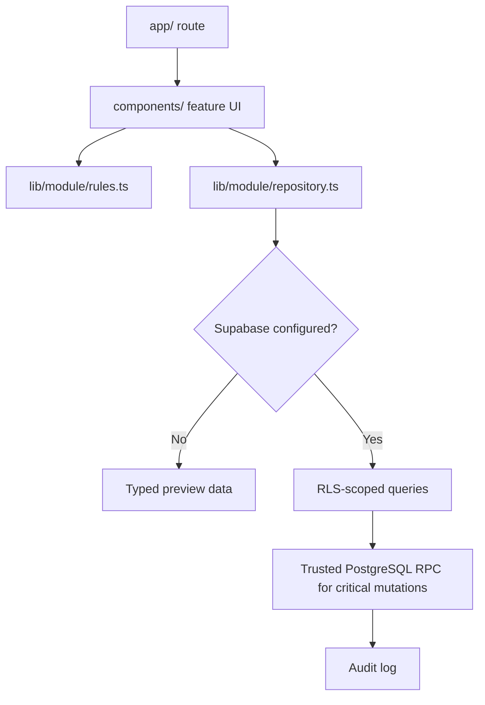
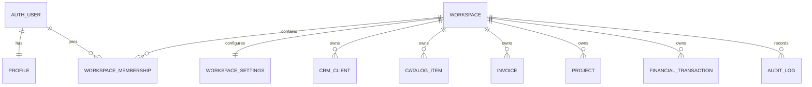
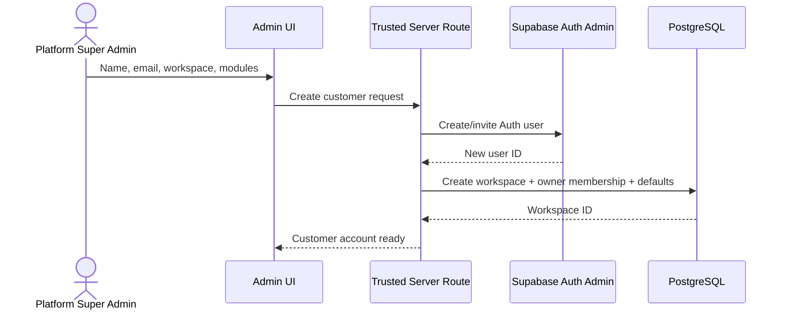
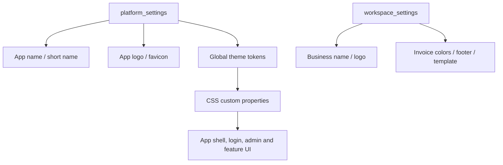
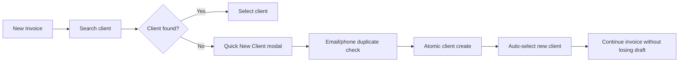
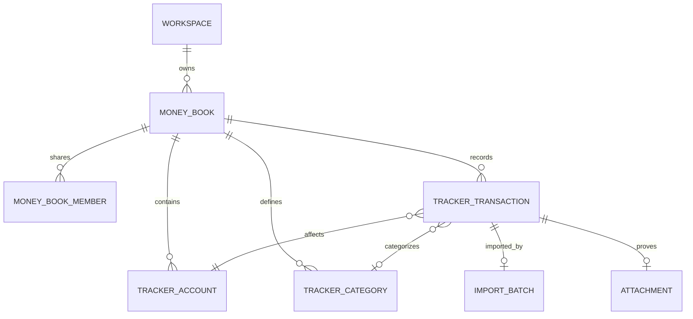
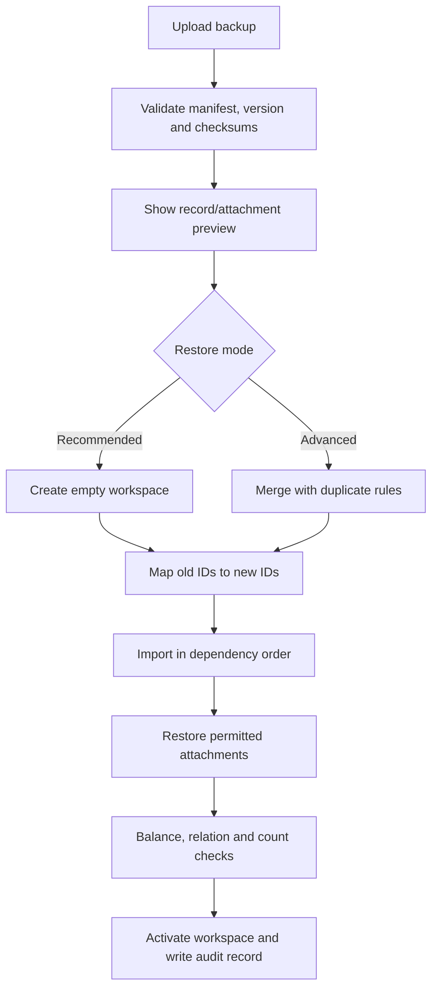
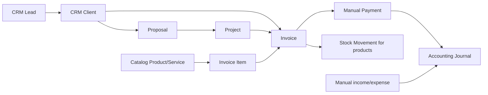

# LedgerDesk Architecture & Product Guide

> **Living document:** এই file LedgerDesk-এর architecture, database design, security boundary, completed features এবং planned development-এর master reference। ভবিষ্যতে architecture, database, route, permission, import/export format বা major feature patch করলে একই commit-এ এই guide update করতে হবে।

**Last reviewed:** 27 October 2026  
**Product:** LedgerDesk Business OS  
**Primary deployment:** Vercel + Supabase + GitHub  
**Cost policy:** Core application কোনো বাধ্যতামূলক paid integration-এর উপর নির্ভর করবে না।

## Status legend

| Marker | Meaning |
|---|---|
| ✅ | Implemented and available in the repository |
| 🟡 | Foundation exists; UI/workflow is incomplete |
| 🔵 | Approved plan; not implemented yet |
| ⚪ | Optional future extension |

## 1. Product goal

LedgerDesk একটি multi-sector, multi-tenant business application। বর্তমান প্রধান focus:

- Inventory ও stock tracking
- Professional invoice, print/PDF, online client invoice ও email workflow
- Freelancing/agency CRM, proposal ও project delivery
- Basic এবং optional full accounting
- Manual cash/bank/mobile-wallet হিসাব
- ভবিষ্যতে branch, factory, purchasing এবং manufacturing extension

পরবর্তী approved focus:

- Invoice Studio থেকে সরাসরি নতুন client তৈরি
- Personal/business Money Tracker
- Platform Super Admin panel
- Global app logo, name ও theme editor
- Admin-created private customer accounts/workspaces
- Full workspace export এবং restorable import

## 2. High-level system picture



### Architecture principle

Browser কখনো platform secret বা service-role credential পাবে না। সাধারণ workspace operation signed-in user session ও RLS দিয়ে চলবে। User creation, cross-workspace export, restore এবং platform administration trusted server-only boundary দিয়ে হবে।

## 3. Technology

| Layer | Technology | Responsibility |
|---|---|---|
| UI | Next.js 16 App Router, React 19, TypeScript | Routes, server/client components, forms |
| Styling | Tailwind CSS 4 + CSS variables | Responsive UI এবং future runtime theme |
| Database | Supabase PostgreSQL | Business data, constraints, transactional functions |
| Identity | Supabase Auth | Sign-in, invitation, recovery, user identity |
| Authorization | PostgreSQL RLS | Workspace and role-based row isolation |
| Files | Supabase Storage | Logo, invoice files, receipts, proofs, attachments |
| Validation | Zod, React Hook Form | Client/server input validation |
| Email | Nodemailer-compatible SMTP | Invoice delivery and reminders |
| Quality | TypeScript, ESLint, Vitest, Next production build | Release gates |

## 4. Runtime layer design



### Code ownership

- `app/`: route entry, route params, API routes এবং layouts
- `components/`: interactive feature workspaces
- `lib/<module>/types.ts`: domain types
- `lib/<module>/rules.ts`: deterministic calculations and validation
- `lib/<module>/repository.ts`: Supabase data access
- `lib/<module>/demo-data.ts`: configuration-free preview data
- `supabase/migrations/`: append-only schema history
- `tests/`: pure domain-rule tests

## 5. Multi-tenant user and database architecture

প্রত্যেক customer-এর জন্য আলাদা physical database তৈরি হবে না। একটি PostgreSQL database-এর মধ্যে প্রত্যেক customer একটি private `workspace` পাবে। এতে migration, maintenance ও free-tier deployment manageable থাকবে।



### Isolation rules

1. প্রতিটি operational row-তে `workspace_id` বাধ্যতামূলক।
2. RLS membership এবং role পরীক্ষা করবে।
3. Cross-workspace foreign key/reference প্রত্যাখ্যাত হবে।
4. Storage path শুরু হবে `<workspace_id>/...` দিয়ে।
5. সাধারণ user অন্য workspace-এর ID জানলেও data পড়তে পারবে না।
6. Platform secret শুধুমাত্র server-side admin/export/import operation-এ ব্যবহৃত হবে।

### User creation flow — planned 🔵



Auth user এবং workspace setup একই orchestrated flow-এ হবে। Partial failure হলে orphan user/workspace cleanup বা recoverable pending state রাখতে হবে। Password, token বা secret export file-এ যাবে না।

## 6. Role model

| Role | Intended access |
|---|---|
| Platform Super Admin | Global users, workspaces, branding, exports, system health |
| Workspace Owner | Entire own workspace and member management |
| Manager | Daily operations, CRM, invoices, inventory, permitted team management |
| Accountant | Accounting, payments, reports, financial export |
| Staff | Assigned operational workflows |
| Viewer | Read-only permitted workspace data |

UI button hide করা authorization নয়। Database RLS এবং trusted function-ই final authority।

## 7. Branding and theme architecture — planned 🔵

Global app branding এবং customer business/invoice branding আলাদা থাকবে।



### Planned global settings

- App name and short name
- Main, compact and login logo
- Favicon
- Primary, accent, sidebar, background and text colors
- Light/dark/system theme
- Font family
- Login heading and support contact
- Global footer

Hard-coded UI colors ধাপে ধাপে semantic CSS variables-এ নিতে হবে:

```css
--brand-primary;
--brand-accent;
--surface-page;
--surface-card;
--sidebar-background;
--text-primary;
--text-muted;
--status-success;
--status-warning;
--status-danger;
```

## 8. Current feature architecture

| Module | Status | Main data/control |
|---|---:|---|
| Authentication and setup | ✅ | Auth session, profile, workspace owner setup |
| Inventory | ✅ | Catalog, immutable stock movement, calculated balance |
| CRM | ✅ | Leads, conversion, clients, contacts |
| Proposals and projects | ✅ | Proposal lines, conversion, tasks and delivery records |
| Invoicing | ✅ | Draft, issue, stock deduction, payment, print/public link/email |
| Basic/full accounting | ✅ | Money account, transaction, double-entry journal |
| Reports | ✅ | Cross-module live report snapshot |
| Team and audit | ✅ | Membership roles, invitations, activity foundation |
| Branch/purchase/manufacturing | 🟡 | Database foundation exists; complete operational UI pending |
| Restorable workspace import | 🔵 | Approved architecture; not implemented |
| Platform Super Admin | 🔵 | Approved architecture; not implemented |
| Runtime global theme editor | 🔵 | Approved architecture; not implemented |
| Money Tracker | 🔵 | Approved architecture; not implemented |

## 9. Invoice client creation improvement — planned 🔵

বর্তমানে Invoice Studio existing active client select করে। Planned improvement:



Minimum client fields:

- Individual/company type
- Client or company name
- Contact person
- Optional email and phone
- Billing address
- Default currency and payment terms

CRM-তেও direct `New Client` action থাকবে; lead conversion একমাত্র পথ হবে না।

## 10. Money Tracker architecture — planned 🔵

এই module business accounting থেকে আলাদা হবে, কিন্তু approved transaction চাইলে পরে accounting-এ post করা যাবে। কোনো direct bank, bKash বা Nagad integration Release 1-এ থাকবে না।



### Money Books

- Personal
- Family
- Freelancing
- Agency cash
- Project-specific book
- Another business

### Account types

- Cash
- Bank
- bKash/Nagad/Rocket/manual mobile wallet
- Online bank
- Savings
- Credit card
- Loan
- Investment
- Custom

### Transaction types

- Income
- Expense
- Transfer

Transfer একটি linked pair/transfer group হবে এবং income/expense report বাড়াবে না। Planned transaction fields:

- `workspace_id`, `money_book_id`, `account_id`, `category_id`
- `transaction_type`, `amount`, `currency`, `occurred_at`
- `transfer_group_id`, `payee`, `note`, `tags`
- `source` (`manual`, `csv_import`, `xlsx_import`, future `provider_api`)
- `external_id`, `import_batch_id`, `import_hash`
- `attachment_path`, `created_by`

`source`, `external_id` এবং `import_hash` future provider integration ও duplicate prevention-এর extension point। এখন কোনো provider credential বা sync worker থাকবে না।

### Money Tracker roadmap

1. Accounts, categories এবং manual transactions
2. Transfer, balances, filter/search এবং cash-flow dashboard
3. CSV/XLSX export এবং JSON backup
4. Import mapping, preview, duplicate detection এবং rollback
5. Budgets, goals, recurring/planned transactions
6. Sharing, reconciliation, split transactions এবং automation rules
7. Optional provider adapter and accounting bridge

## 11. Export and restorable import architecture — planned 🔵

বর্তমান JSON export একটি foundation; complete restore engine এখনো নেই। Human-readable export এবং full restore backup আলাদা হবে।

### Export formats

- CSV: module/filter-based portable rows
- XLSX: readable multi-sheet business export
- JSON: structured machine-readable data
- ZIP: full restorable backup plus attachments

### Canonical backup package

```text
ledgerdesk-backup.zip
├── manifest.json
├── workspace.json
├── settings.json
├── members.json
├── crm.json
├── inventory.json
├── projects.json
├── invoices.json
├── accounting.json
├── money-tracker.json
├── audit-log.json
└── attachments/
```

`manifest.json`-এ থাকবে:

- Backup format এবং schema version
- Original workspace ID
- Created time, timezone এবং currency
- Included modules এবং record counts
- File checksums
- Attachment manifest
- Minimum compatible application version

### Restore flow



### Import rules

1. Auth passwords, tokens এবং platform secrets কখনো import/export হবে না।
2. New Auth user আলাদাভাবে server-side তৈরি/invite হবে।
3. Old UUID সরাসরি reuse না করে old-to-new ID mapping হবে।
4. New workspace restore default mode; merge advanced mode।
5. Import batch atomic/recoverable হবে; failure-এ partial live workspace থাকবে না।
6. SKU, email, invoice number, reference এবং `import_hash` দিয়ে duplicate detection হবে।
7. Restore activate করার আগে stock, invoice, payment, journal এবং account balance verify হবে।
8. Export/import action audit log-এ থাকবে।

## 12. Platform Super Admin architecture — planned 🔵

### Planned routes

```text
/admin
/admin/users
/admin/users/[id]
/admin/workspaces
/admin/appearance
/admin/exports
/admin/activity
/admin/system
```

### Admin capabilities

- Create/invite/suspend/reactivate customer
- Create private workspace and select enabled modules
- View workspace status, storage usage and last activity
- Trigger full workspace export
- Restore backup into a new customer/workspace
- Configure global name, logo and theme
- Review audit, email queue, migration and system health

Platform administration server-only authorization ব্যবহার করবে। সাধারণ workspace owner platform admin হবে না।

## 13. Core data map



Critical operations—stock movement, invoice issue, payment, journal posting, proposal conversion এবং future restore activation—transactional database function দিয়ে হবে।

## 14. Security and privacy checklist

- Every exposed operational table uses RLS
- Grants and policies are reviewed together
- `workspace_id` and membership lookup columns are indexed
- Platform secret/service-role key is server-only
- Public invoice stores only a hash of the random token
- Private files use workspace-scoped Storage paths
- Financial posted records are corrected through reversal, not silent rewrite
- Export download is short-lived and audited
- Import validates file type, size, schema and checksum
- No password/auth token inside backups
- Destructive replace/delete requires a fresh safety export and typed confirmation
- Cross-tenant allow/deny database tests are required before production data

## 15. Migration and schema rules

1. Applied migration কখনো edit করা যাবে না; নতুন timestamped migration যোগ করতে হবে।
2. Table-এর সঙ্গে একই migration-এ RLS/grant/index দিতে হবে।
3. Multi-row এবং financial mutation trusted function-এ রাখতে হবে।
4. Client-provided `workspace_id`, total, balance বা role blindly trust করা যাবে না।
5. New foreign keys workspace boundary অতিক্রম করতে পারবে না।
6. Currency amount floating-point নয়; PostgreSQL `numeric` এবং application decimal-safe calculation ব্যবহার করবে।
7. Import-compatible schema change হলে backup format version/migrator update করতে হবে।
8. Storage metadata database backup-এর সমান নয়; actual files আলাদাভাবে handle করতে হবে।

## 16. UI/UX rules

- নতুন user-এর জন্য empty state-এ পরবর্তী action স্পষ্ট থাকবে
- Modal/form submit-এ loading, success এবং actionable error দেখাতে হবে
- Desktop এবং mobile দুটোতেই primary workflow usable হতে হবে
- Role অনুযায়ী navigation এবং action দেখাবে; database permission অবশ্যই আলাদা থাকবে
- Destructive action visual warning এবং confirmation চাইবে
- Search, filter, recent items এবং keyboard-friendly fields ব্যবহার করতে হবে
- Bangla guide সহজ হবে; code/database identifiers English থাকবে
- Preview mode স্পষ্ট label করবে; demo data কখনো live data হিসেবে দেখাবে না

## 17. Implementation phases

### Phase A — Invoice and client UX

- Direct CRM client creation
- Invoice Studio quick client modal
- Searchable selector, duplicate warning এবং auto-selection

### Phase B — Money Tracker core

- Money books, accounts, categories
- Manual income/expense/transfer
- Balances, transaction history এবং cash-flow dashboard
- CSV/XLSX export

### Phase C — Platform administration and branding

- Server-only platform admin authorization
- Customer creation/invitation and workspace provisioning
- Global app name/logo/theme editor
- User/workspace management UX

### Phase D — Portable backup and restore

- Versioned ZIP/JSON format
- Full workspace export jobs
- Restore validation, preview and ID mapping
- New-workspace restore, attachments and integrity report

### Phase E — Money Tracker advanced

- CSV/XLSX mapping import
- Budgets, goals and planned transactions
- Sharing, reconciliation, split transactions and rules
- Optional future provider adapter

## 18. Definition of done

কোনো phase complete বলা যাবে যখন:

- Database migration, RLS, indexes and rollback/recovery behavior are reviewed
- UI has loading, empty, success and error states
- Mobile and desktop primary workflow works
- Domain tests and permission tests cover critical rules
- `npm run typecheck`, `npm run lint`, `npm test`, `npm run build` pass
- No secret or real customer data is committed
- User guide, developer guide, implementation status and this master guide are updated
- Git diff is reviewed and the release commit is traceable

## 19. Required documentation patch protocol

প্রতিটি future patch-এ developer নিচের checklist অনুসরণ করবে:

1. এই guide-এর relevant section update
2. Status marker (`🔵` → `🟡` → `✅`) update
3. নতুন/পরিবর্তিত table, route, RPC এবং permission document
4. Diagram পরিবর্তিত হলে Mermaid diagram update
5. Backup compatibility বদলালে format/schema version update
6. `IMPLEMENTATION_STATUS.md` এবং প্রয়োজন হলে `USER_GUIDE_BN.md` update
7. নিচের change log-এ concise entry যোগ

## 20. Architecture change log

| Date | Change | Status |
|---|---|---|
| 2026-10-27 | Master architecture guide created; invoice client UX, Money Tracker, Platform Admin, global branding and restorable workspace backup plans recorded | Planned |

## Reference documents

- `NEXT_DEVELOPMENT_PLAN.md` — approved next-development execution order, tasks and acceptance criteria
- `README.md` — quick project introduction
- `DEVELOPER_GUIDE.md` — current implementation conventions
- `USER_GUIDE_BN.md` — end-user instructions
- `IMPLEMENTATION_STATUS.md` — release status and verification
- `DEPLOYMENT_AND_SECRETS.md` — environment and deployment
- `supabase/README.md` — database migration order
- [Supabase Row Level Security](https://supabase.com/docs/guides/database/postgres/row-level-security)
- [Supabase Auth users](https://supabase.com/docs/guides/auth/users)
- [Supabase Storage access control](https://supabase.com/docs/guides/storage/security/access-control)
- [Supabase backups](https://supabase.com/docs/guides/platform/backups)
