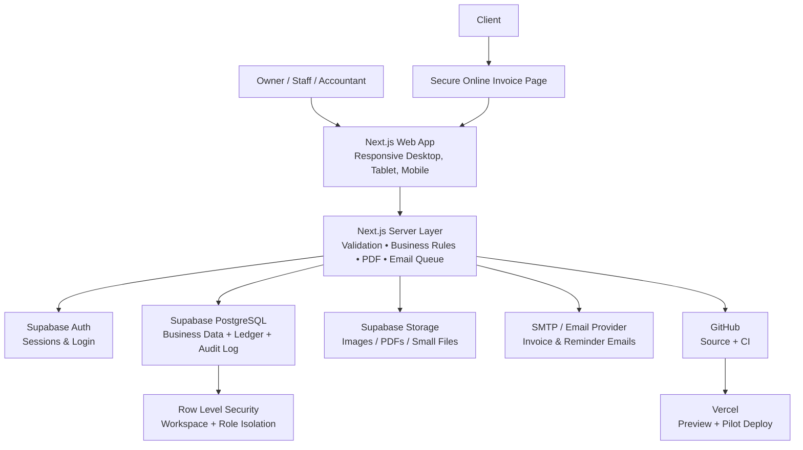

# Master Execution Plan
## Inventory, Professional Invoice & Freelancing Business Management App

**Status:** Planning approved for review; implementation starts only after owner approval.
**Primary release:** Inventory + Invoice + Freelancing/Digital Service Management
**Future-ready scope:** Retail POS, Factory/Manufacturing, Multi-Branch, Client Portal, Integrations

---

## 1. Product Vision

একটি professional, modular web application তৈরি হবে যেটি প্রথমে agency/freelancing business-এর হিসাব, client, project, invoice এবং inventory চালাবে। একই application ভবিষ্যতে অন্য business sector-এর জন্য চালু করা যাবে—পুরো system নতুন করে তৈরি করার দরকার হবে না।

### Primary outcomes

1. Product stock ও inventory history সঠিকভাবে রাখা
2. Professional invoice তৈরি, print, PDF download ও online client sharing
3. সুন্দর branded invoice/email দিয়ে agency-এর professional image তৈরি
4. Freelancing client, proposal, project, milestone, payment, due এবং profit tracking
5. সহজ Basic Accounting; প্রয়োজন হলে Full Accounting চালু করা
6. Future-এ POS, factory ও branch module add করার মতো architecture রাখা

### Release 1 exclusions

- Payment gateway integration
- Thermal printer, barcode scanner ও cash drawer integration
- Full counter POS workflow
- Factory production workflow
- Multi-branch operations

এই feature-গুলোর database/module boundary থাকবে; কিন্তু Release 1-এ build করা হবে না।

### First-run setup and tenancy decision

- The first registered account becomes the Business Super User/Owner of a new workspace.
- On first login, an onboarding wizard collects business identity, language, currency, accounting mode, services, inventory units, invoice branding and team preferences.
- The owner can change these settings later; onboarding values are not hard-coded by the developer.
- All businesses initially share one Supabase PostgreSQL project, but every business record is isolated by `workspace_id` and Row Level Security.
- A Platform Super Admin can manage workspace lifecycle and system health without bypassing financial audit rules.
- A large client can later be migrated to a dedicated Supabase project/database through the provider abstraction and export/import process.

---

## 2. Release 1: Main Features

### A. Inventory Management

- Product ও Service একই catalog-এ থাকবে; Service-এর stock থাকবে না
- Product image, category, code/SKU, unit, purchase cost, selling price ও tax rule
- Opening stock, stock-in, stock-out, adjustment, damage/loss ও reason
- Immutable stock ledger: কোন user, কখন, কোন invoice বা adjustment থেকে stock বদলেছে
- Current stock, low-stock threshold, low-stock alert-ready state
- Inventory value, stock movement এবং adjustment report
- Product label: name, code, price, optional barcode area; A4 label-sheet print
- Product invoice হলে stock কমবে; service invoice হলে stock বদলাবে না

### B. Professional Invoice System

- Invoice types: Digital Service, Product Sale, Mixed Product + Service, Credit Note
- Status: Draft, Issued, Viewed, Partially Paid, Paid, Overdue, Cancelled
- Configurable invoice number, prefix, currency, due date, payment instructions and notes
- Manual payment: Cash, Bank, Online Bank, Mobile Wallet, Other
- Partial payment, due, payment proof image/PDF, payment reference and reversal
- A4 print and downloadable PDF
- Invoice version stored after issue, so old invoices never change due to later template edits

### C. Invoice Template Studio

- Starter templates: Modern Agency, Minimal, Classic Business, Detailed Tax
- Owner selects default template; each invoice can select another template
- Brand configuration: logo, business information, primary/accent color, footer, signature, bank details and terms
- Field controls: show/hide client address, item code, tax, discount, due date, note, signature and payment reference
- Custom item-table columns, labels, totals and language/currency format
- Live preview before issuing, printing or sending
- Future: custom drag/drop designer can be added without changing issued invoice data

### D. Online Client Invoice

- A secure, unguessable public link for each issued invoice
- Mobile/desktop branded invoice page with view, PDF download and payment instructions
- Link expiry, disable/revoke option, email verification option and view history
- Client only views/downloads; no client-side invoice edit
- Online view uses agency logo, color and selected invoice template

### E. Invoice Email & Agency Branding

- Email templates: Invoice Sent, Payment Reminder, Overdue Reminder, Payment Received, Thank You
- Editable email subject, greeting, body, footer, signature, button text and brand colors
- Dynamic variables: client name, invoice number, amount, due date, project/service and online link
- Preview, test email, send, resend and email delivery log
- PDF attachment only for small invoices; secure online invoice link is default
- Email provider will use a configurable SMTP/API adapter; owner supplies sender email/domain and credentials when direct client sending is enabled

### F. Freelancing / Digital Service Management

- Lead source and pipeline: New, Contacted, Proposal Sent, Negotiation, Won, Lost
- Client profile, country, contacts, tags, notes, files and history
- Service catalog and package tiers: Basic, Standard, Premium
- Proposal/quotation with version, validity, A4 PDF/print and acceptance status
- Project, task, milestone, deadline, deliverable, revision and optional time tracking
- Project budget versus actual income, expense, due and profit
- External cloud links for large client files (Google Drive/OneDrive/Dropbox)

### G. Accounting & Reports

**Basic Accounting (default):** income, expense, cash/bank balance, due and profit report.

**Full Accounting (optional):** chart of accounts, double-entry ledger, journal, trial balance, profit & loss, balance sheet, cash flow, opening balance and period lock.

Important rule: even Basic mode will write ledger-safe financial records. The simple UI is optional; correctness of data is not optional.

---

## 3. Future Development Map

| Module | Future capability |
|---|---|
| Retail POS | Fast counter sale, return/exchange, receipt, discount, hardware support |
| Purchase & Supplier | Purchase order, receiving, supplier due, purchase return |
| Advanced Inventory | Barcode, batch/serial/expiry, stocktake, transfer, warehouse |
| Factory | Raw material, BOM, production order, wastage, finished goods, costing |
| Branch | Up to 5–6 branches, branch users, central report, stock transfer |
| Client Portal | Client login, quotation approval, invoice/history, file delivery |
| Communication | WhatsApp/SMS reminder, automated campaign and notification |
| Payment | bKash/Nagad/bank/card payment gateway integration |
| Mobile/PWA | Installable app, offline-safe capture and later synchronization |
| AI | Demand forecast, reorder suggestion, invoice OCR, anomaly detection |

---

## 4. Technology Stack

| Area | Technology | Why it is used |
|---|---|---|
| Web application | Next.js + React + TypeScript | One modern codebase for UI, server routes and Vercel deployment |
| UI system | Tailwind CSS + reusable UI components | Responsive, consistent, fast design work |
| Forms & validation | React Hook Form + Zod | Safe, clear, validated data entry |
| Database | Supabase PostgreSQL | Relational data for invoices, inventory and accounting |
| Authentication | Supabase Auth | Secure sign-in, session and password reset |
| Permission | Supabase Row Level Security + server authorization | Prevent users accessing unauthorized business data |
| File storage | Supabase Storage | Image, PDF and small document attachments |
| Charts/tables | Recharts + TanStack Table | Business reports and filterable data tables |
| PDF/print | HTML invoice templates + print CSS + server PDF renderer | High-quality A4 invoice, quotation, voucher and label output |
| Email | Provider-independent SMTP/API adapter | Allows email provider change without rewriting invoice features |
| Testing | Vitest, Playwright and TypeScript checks | Unit, workflow and browser testing |
| Source control | GitHub | Version history, reviews and backups of code |
| CI | GitHub Actions | Automated lint, type-check, test and build checks |
| Hosting | Vercel | Preview deployment and pilot hosting |

### Free-first infrastructure rules

1. Supabase Free provides database, authentication, storage and API for the first demo/pilot.
2. Store only small files in Supabase; use external cloud links for large design/video files.
3. Direct client email cannot rely on Supabase's default development email service. Configure a separate SMTP/email provider before production invoice sending.
4. Vercel Hobby is for development/demo under its terms; select a commercial-appropriate host/plan before a public business production launch.
5. Keep periodic database exports and attachment inventory outside the free platforms.

Reference: [Supabase pricing](https://supabase.com/pricing), [Supabase custom SMTP guidance](https://supabase.com/docs/guides/auth/auth-smtp), [Vercel terms](https://vercel.com/legal/terms).

---

## 5. System Architecture



### Architecture principles

- **Multi-workspace ready:** every business record includes a workspace/business identity.
- **Service + product friendly:** same invoice can contain both services and stock products.
- **Immutable ledgers:** stock and financial history are not editable counters.
- **Module boundaries:** invoice/inventory/freelancing/POS/factory features remain separate but share common data.
- **Template versioning:** issued invoice keeps its own snapshot of template and business details.
- **Provider abstraction:** email, printing and future payment providers can change with limited impact.
- **Secure public links:** online invoice uses a hashed token, expiry, revocation and audit events.

---

## 6. Data Design

### Common entities

`workspaces`, `users`, `memberships`, `roles`, `permissions`, `audit_logs`, `attachments`, `settings`, `number_sequences`

### CRM & freelancing entities

`leads`, `clients`, `client_contacts`, `services`, `service_packages`, `proposals`, `proposal_items`, `projects`, `tasks`, `milestones`, `deliverables`, `revisions`

### Inventory & invoice entities

`products`, `product_categories`, `units`, `stock_movements`, `stock_balances`, `stock_adjustments`, `invoices`, `invoice_items`, `invoice_template_versions`, `invoice_public_links`, `payments`, `payment_proofs`, `credit_notes`, `email_templates`, `email_deliveries`

### Finance entities

`accounts`, `journal_entries`, `journal_lines`, `expenses`, `income_records`, `financial_periods`, `reversals`

### Critical integrity rules

1. Stock balance is calculated/verified from `stock_movements`; it is never blindly edited.
2. Issued invoice stores a snapshot of invoice template, logo/business information and totals.
3. Invoice payment, stock movement and financial ledger posting happen in one database transaction.
4. Cancel/return/adjustment creates a reversing record; no silent deletion of history.
5. Every customer-facing public link is revocable and never exposes internal records.
6. Database policy and server code both enforce workspace and role access.

---

## 7. Application Structure

```text
project-root/
├── app/
│   ├── (auth)/                 # Login, reset password
│   ├── (dashboard)/            # Authenticated application screens
│   │   ├── dashboard/
│   │   ├── inventory/
│   │   ├── invoices/
│   │   ├── clients/
│   │   ├── proposals/
│   │   ├── projects/
│   │   ├── accounting/
│   │   ├── reports/
│   │   └── settings/
│   ├── invoice/[token]/        # Public online invoice page
│   └── api/                    # Server-side protected actions
├── components/
│   ├── ui/                     # Reusable design-system components
│   ├── invoices/               # Templates, preview and print components
│   ├── inventory/
│   └── shared/
├── lib/
│   ├── supabase/               # Browser/server auth and database clients
│   ├── permissions/            # Role checks
│   ├── accounting/             # Posting and reversal rules
│   ├── inventory/              # Stock movement rules
│   ├── invoices/               # Numbering, totals, public-link rules
│   ├── email/                  # Provider adapter and template rendering
│   └── validation/             # Zod schemas
├── supabase/
│   ├── migrations/             # Versioned SQL schema changes
│   ├── functions/              # Optional server/database functions
│   └── seed.sql                # Safe development seed data
├── tests/
│   ├── unit/
│   ├── integration/
│   └── e2e/
├── docs/
│   └── (created during final documentation phase)
├── .github/workflows/
├── MASTER_EXECUTION_PLAN.md
└── README.md
```

---

## 8. UI & Design Direction

### Product personality

- Clean, modern and trustworthy agency/business appearance
- Spacious layout, readable typography and strong financial hierarchy
- Professional navy/indigo base with configurable brand accent color
- Light/dark mode can be added after core workflow is stable
- Bangla + English-ready labels; invoice language independently selectable

### Core screens

1. Business Dashboard
2. Inventory List and Stock Movement Detail
3. Invoice List, Invoice Editor and Template Preview
4. Online Client Invoice Page
5. Email Template Editor and Delivery History
6. Client Profile and Timeline
7. Proposal and Project Workspace
8. Cash/Bank, Income/Expense and Accounting Reports
9. Business Branding, Templates, Roles and Settings

---

## 9. Phased Implementation Plan

### Phase 0 — Final Decisions & UX Blueprint (3–5 working days)

- Define the first-run onboarding wizard for business identity, currencies, language and branding
- Define onboarding steps for invoice template, inventory units/categories and accounting mode
- Define Platform Super Admin versus Business Super User/Owner permissions
- Define shared-database workspace isolation and future dedicated-database migration boundary
- Approve default wireframes and print samples; real business values are entered by the owner inside the app

**Acceptance:** Approved scope, workflows, wireframes and test examples exist.

### Phase 1 — Foundation & Security (1 week)

- Next.js, Supabase, GitHub and Vercel development environment
- Login, workspace, roles, permissions, settings and audit log
- Shared layout, sector/module toggles and database migration baseline

**Acceptance:** Authorized users sign in and only see allowed workspace data.

### Phase 2 — Inventory & Label Foundation (1–2 weeks)

- Product/service catalog, unit, category, price and stock settings
- Opening stock, stock-in/out, adjustment, damage/loss and stock ledger
- Low-stock state, stock value/movement reports
- A4 product label print template

**Acceptance:** all stock changes are traceable and balance correctly.

### Phase 3 — CRM, Proposals & Project Workflow (1–2 weeks)

- Leads, clients, services, packages and quotation
- Proposal-to-project conversion
- Tasks, milestones, deliverables, revisions, attachments and external links

**Acceptance:** a lead can become a client, proposal and managed project.

### Phase 4 — Invoice Studio & Online Client Invoice (2–3 weeks)

- Product/service/mixed invoice and invoice numbering
- Professional template selection, branding, preview, A4 print and PDF
- Stock deduction from product invoice
- Secure online client link, expiry/revocation and view logs
- Manual payment, partial payment, due and payment proof

**Acceptance:** a branded client invoice can be issued, printed, shared online and reconciled with stock/payment.

### Phase 5 — Email, Basic Accounting & Reports (1–2 weeks)

- Invoice/reminder email templates, preview, delivery log and provider adapter
- Cash/bank/online-bank accounts; income, expense, due and profit
- Core dashboard, inventory, project and finance reports

**Acceptance:** after SMTP credentials are supplied, invoice emails send with correct branding; financial totals reconcile.

### Phase 6 — Full Accounting Toggle (1–2 weeks)

- Chart of accounts, journals, trial balance, ledger, P&L, balance sheet and cash flow
- Period lock, reversal/adjustment and accountant permission rules

**Acceptance:** Basic and Full modes correctly show the same underlying financial truth at different detail levels.

### Phase 7 — Quality, Pilot & Handover (1–2 weeks)

- Unit, integration and browser workflow tests
- Print/PDF/label testing on target inkjet/laser printer
- Permission, stock, invoice, public-link and finance security tests
- Vercel/Supabase pilot, backup/export test and feedback fixes

**Acceptance:** real sample workflow passes without manual data repair.

### Estimated timeline

| Release | Estimated duration |
|---|---:|
| Phases 0–5: Inventory + Invoice + Freelancing + Basic Accounting | 8–12 weeks |
| Phases 6–7: Full Accounting + Pilot + Documentation | 3–5 weeks |
| Total Release 1 | 11–17 weeks |

---

## 10. Quality & Testing Strategy

### Required checks after each approved phase

- Lint
- Type-check
- Unit tests for business rules
- Relevant integration tests
- Production build
- Manual smoke test of the affected screen/workflow

### High-risk test cases

1. Invoice with product reduces stock exactly once.
2. Double-click/retry cannot create duplicate invoice or payment.
3. Partial payment preserves correct due and ledger entries.
4. Cancellation/reversal restores stock/finance by history, not deletion.
5. User from another workspace cannot access invoice, stock or attachment.
6. Disabled/expired public invoice link cannot display data.
7. Template changes do not alter already-issued invoices.
8. Inventory totals, invoice totals and financial reports agree.
9. Export/backup can be read and restore-tested.

---

## 11. Final Documentation Deliverables

**These guides will be created after the application is built, tested and pilot-reviewed—not before implementation.**

| File | Purpose |
|---|---|
| `README.md` | Local setup, commands, environment variables and quick start |
| `docs/USER_GUIDE.md` | Owner/staff guide with day-to-day screenshots and workflow |
| `docs/ADMIN_GUIDE.md` | Branding, templates, users, roles, settings, backup and restore |
| `docs/DEVELOPER_GUIDE.md` | Architecture, folder structure, database rules, coding standards and extension guide |
| `docs/INVOICE_TEMPLATE_GUIDE.md` | How to add/edit templates, email templates and print layouts safely |
| `docs/ACCOUNTING_GUIDE.md` | Basic/Full accounting behavior, ledger posting and reversal rules |
| `docs/DEPLOYMENT_GUIDE.md` | Supabase, Vercel, SMTP, domain, secrets, migrations and release process |
| `docs/FUTURE_MODULE_GUIDE.md` | Safe roadmap for POS, factory, branch, payment and AI modules |
| `CHANGELOG.md` | Version history, released features and upgrade notes |

Every guide will be based on the actual completed codebase and verified commands—not assumptions written in advance.

---

## 12. Codex Execution Guide

### Recommended model

For this full project, choose **Sol** with **High** reasoning. Use **Extra High** for accounting schema, RLS/security, difficult errors, database migrations and architecture decisions. Use Terra only for isolated small UI/content changes when speed matters.

### Recommended mode

1. **Plan mode** — before each phase, scope change, financial rule, data migration or security-sensitive task.
2. **Build/Default mode** — after the phase is approved; implement only that phase, then test and stop.
3. **Plan mode again** — when review reveals a change or before entering the next phase.

### Execution prompt

Use this prompt when work starts:

> Read `MASTER_EXECUTION_PLAN.md` as the authoritative product specification. Implement the phases in order. Start with Phase 0 and then Phase 1 only after approval. Build only the approved phase; do not start later phases automatically. Use Supabase-first architecture. Run lint, type-check, relevant tests and production build after every phase. Repair failures before reporting completion. Do not add paid services, payment gateways, POS hardware, factory modules or branches unless explicitly approved. Create final documentation only in Phase 7 after the finished system has been verified.

---

## 13. Owner Input Strategy

No business identity or catalog details are required before coding. The application collects these through the first-run Setup Wizard and later Settings screens.

Only external service configuration is required later:

1. Supabase project environment values when connecting the real backend
2. GitHub/Vercel access when preview deployment is approved
3. Sender domain/address and SMTP/email-provider credentials when real client email delivery is enabled
4. Target printer and paper/label samples during Phase 7 verification

Secrets must be stored in environment variables or protected provider settings, never pasted into source control or exposed to normal users.

---

## 14. Start Condition

This document is the single execution source of truth. After owner approval, implementation starts with **Phase 0**. Business-specific values are collected through onboarding; Section 13 external configuration is supplied only when its phase needs it. No future module is built early unless the owner explicitly changes this plan.
