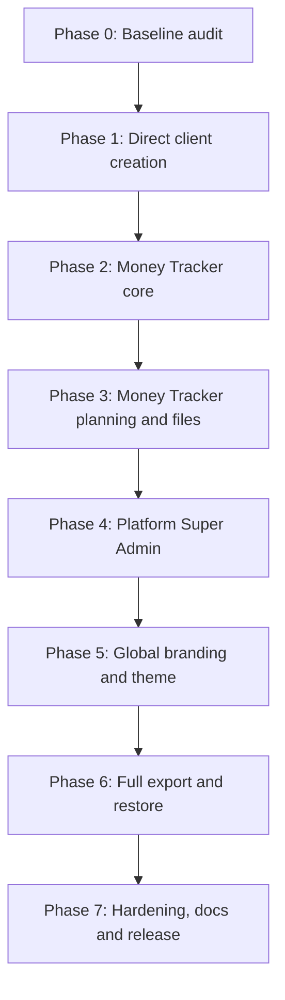

# LedgerDesk Next Development Plan

> **Purpose:** 24–27 October 2026 পর্যন্ত আলোচনা করে অনুমোদিত পরবর্তী development কাজগুলোর execution-ready backlog। ভবিষ্যতে user শুধু বলবেন: **“`NEXT_DEVELOPMENT_PLAN.md` অনুযায়ী development শুরু করো”**—তখন developer/AI এই file এবং `ARCHITECTURE_AND_PRODUCT_GUIDE.md` সম্পূর্ণ পড়ে নিচের phase order অনুযায়ী কাজ শুরু করবে।

**Created:** 27 October 2026  
**Current baseline commit before this plan:** `85f5d8e`  
**Repository:** `DeveloperMahmud/ledger_desk_pos`  
**Default branch:** `main`

## 1. Approved requirements summary

পরবর্তী development-এ নিম্নলিখিত বিষয়গুলো করতে হবে:

1. Invoice তৈরির সময় সরাসরি নতুন client যোগ করা।
2. CRM থেকে lead conversion ছাড়াই direct client তৈরি করা।
3. Searchable client selector, duplicate warning এবং inline client edit।
4. আলাদা Personal/Business **Money Tracker** module।
5. Cash, Bank, bKash, Nagad, Rocket, Online Bank, Savings ইত্যাদি manual account।
6. Custom income/expense category এবং subcategory।
7. Manual Income, Expense এবং Account Transfer।
8. Account balance, cash flow, category spending এবং financial dashboard।
9. CSV/XLSX transaction export এবং import।
10. JSON/ZIP full workspace backup ও restorable import।
11. Platform Super Admin panel।
12. Super Admin থেকে নতুন full application user/customer তৈরি।
13. প্রত্যেক customer-এর data database level-এ অন্য customer থেকে আলাদা রাখা।
14. App name, logo, favicon এবং complete theme Admin Panel থেকে পরিবর্তন।
15. নির্দিষ্ট user/workspace-এর সব data UI থেকে export করা।
16. Export করা data দিয়ে একই বা নতুন user/workspace restore করা।
17. Direct banking/mobile-wallet integration এখন থাকবে না।
18. ভবিষ্যতে provider integration যোগ করা যায় এমন backend extension point থাকবে।

## 2. Fixed product decisions

এগুলো implementation-এর সময় নতুন করে সিদ্ধান্ত নেওয়ার প্রয়োজন নেই:

- Bank, bKash, Nagad বা Rocket API এখন connect করা হবে না।
- সব money account ও transaction শুরুতে manual হবে।
- কোনো বাধ্যতামূলক paid subscription/service যোগ করা যাবে না।
- Hosting target: Vercel free tier।
- Backend target: Supabase Auth, PostgreSQL, RLS এবং Storage।
- GitHub repository source of truth থাকবে।
- Configuration/secrets development-এর শেষে করা যাবে; preview mode নষ্ট করা যাবে না।
- প্রত্যেক user-এর জন্য আলাদা physical database নয়; একটি database-এর মধ্যে private workspace/tenant থাকবে।
- প্রত্যেক operational row `workspace_id` দিয়ে isolated থাকবে।
- Global application branding এবং customer invoice/business branding আলাদা থাকবে।
- Business Accounting এবং Personal Money Tracker আলাদা ledger/module হবে।
- Money Tracker transaction accounting-এ স্বয়ংক্রিয়ভাবে যাবে না; future explicit approval/posting bridge থাকবে।
- Full restore-এর canonical format হবে versioned JSON/ZIP; CSV/XLSX মূলত readable/portable data exchange-এর জন্য।
- প্রথম restore mode হবে **Restore into a new empty workspace**। Destructive replace/complex merge পরে।

## 3. Required reading before implementation

Development শুরু করার আগে এই order-এ পড়তে হবে:

1. `AGENTS.md`
2. `ARCHITECTURE_AND_PRODUCT_GUIDE.md`
3. এই `NEXT_DEVELOPMENT_PLAN.md`
4. `DEVELOPER_GUIDE.md`
5. `IMPLEMENTATION_STATUS.md`
6. `supabase/README.md`
7. Relevant Next.js 16 documentation under `node_modules/next/dist/docs/`

তারপর current Git status, latest migration, package versions এবং existing tests inspect করতে হবে।

## 4. Overall execution order



একটি phase-এর acceptance criteria পূরণ না হলে পরবর্তী phase complete বলা যাবে না। Safe independent work parallel করা গেলেও database dependency order বজায় রাখতে হবে।

---

## Phase 0 — Baseline audit and safeguards

**Status:** ✅ Complete (27 October 2026)

### Tasks

- [ ] Git working tree clean কিনা দেখুন।
- [ ] Latest migration number এবং schema inspect করুন।
- [ ] Current app routes এবং repository boundaries verify করুন।
- [ ] Existing preview mode এবং live Supabase mode দুটো document করুন।
- [ ] `npm run typecheck`, `npm run lint`, `npm test`, `npm run build` baseline চালান।
- [ ] New migrations `012`-এর পরে timestamp/order অনুযায়ী শুরু করুন।
- [ ] Work phases-এর জন্য rollback/recovery approach নির্ধারণ করুন।

### Acceptance criteria

- Existing build/test failure নেই অথবা pre-existing failure আলাদাভাবে recorded।
- কোনো user secret বা `.env.local` commit করা হয়নি।
- Architecture guide ও this plan current code-এর সঙ্গে consistent।

---

## Phase 1 — Direct client creation and Invoice Studio UX

**Status:** ✅ Complete (27 October 2026)
**Priority:** Highest; current visible usability gap

### Database/backend

- [ ] Audited `create_crm_client` trusted RPC তৈরি করুন।
- [ ] Workspace permission owner/manager/staff অনুযায়ী enforce করুন।
- [ ] Individual/company client type support করুন।
- [ ] Email ও phone optional রাখুন; normalized duplicate check দিন।
- [ ] Billing address, default currency এবং default payment terms support করুন।
- [ ] Direct client creation audit log লিখুন।
- [ ] Cross-workspace client creation reject করার database test দিন।

### CRM UI

- [ ] CRM Clients view-তে `New Client` button।
- [ ] Create/edit client modal।
- [ ] Empty state এবং search।
- [ ] Duplicate warning; প্রয়োজন হলে existing client open/select action।
- [ ] Archive/reactivate client foundation।

### Invoice Studio UI

- [ ] Searchable client combobox।
- [ ] `+ New Client` inline action।
- [ ] Invoice draft না হারিয়ে modal open/close।
- [ ] New client save হলে auto-select।
- [ ] Empty client list onboarding।
- [ ] Selected client quick edit/view action।
- [ ] Live এবং preview mode দুটোতে safe behavior।

### Acceptance criteria

- Invoice screen ছাড়াই নতুন client create ও select করা যায়।
- Duplicate email/phone-এ পরিষ্কার warning আসে।
- Invalid বা unauthorized request database-এ ঢোকে না।
- Draft lines/title/date client modal ব্যবহারে হারায় না।
- Mobile ও desktop flow usable।

---

## Phase 2 — Money Tracker core

**Status:** ✅ Complete (27 October 2026)

### New domain tables

Final naming implementation-এর সময় schema consistency দেখে নির্ধারণ করা যাবে, তবে domainগুলো থাকবে:

- `money_books`
- `money_book_memberships`
- `tracker_accounts`
- `tracker_categories`
- `tracker_transactions`
- `tracker_transfer_groups` অথবা equivalent linked-transfer design
- `tracker_attachments` metadata অথবা existing private storage reference

### Required fields and rules

#### Money Book

- [ ] Workspace-scoped book
- [ ] Personal, Family, Freelancing, Agency এবং Custom type
- [ ] Owner এবং optional shared members
- [ ] Default currency
- [ ] Active/archive state

#### Accounts

- [ ] Cash
- [ ] Bank
- [ ] bKash
- [ ] Nagad
- [ ] Rocket
- [ ] Online bank
- [ ] Savings
- [ ] Credit card
- [ ] Loan
- [ ] Investment
- [ ] Custom
- [ ] Opening balance, currency, icon/color, include-in-total, archive

#### Categories

- [ ] Income/expense category
- [ ] Parent/subcategory
- [ ] User-created name, icon and color
- [ ] Default seeded categories
- [ ] Archive without breaking historical transaction

#### Transactions

- [ ] Income
- [ ] Expense
- [ ] Transfer
- [ ] Amount, currency, date/time, account, category
- [ ] Payee/person, note, tags and reference
- [ ] Pending/cleared status
- [ ] Source: manual, CSV import, XLSX import, future provider API
- [ ] `external_id`, `import_batch_id`, `import_hash`
- [ ] Created by and audit trail

### Transfer integrity

- [ ] Transfer atomic trusted RPC দিয়ে create হবে।
- [ ] Source account কমবে এবং destination account বাড়বে।
- [ ] Transfer income/expense summary-তে গণনা হবে না।
- [ ] দুই side linked থাকবে; edit/reverse একসঙ্গে হবে।
- [ ] Negative balance policy account-level configurable অথবা প্রথম release-এ explicit validation।

### UI/routes

Planned routes:

```text
/money
/money/accounts
/money/transactions
/money/categories
/money/reports
```

- [ ] Mobile-friendly quick add Income/Expense/Transfer
- [ ] Account cards with balances
- [ ] Transaction history with search/filter
- [ ] Category/account/date/user filters
- [ ] Cash-flow chart
- [ ] Income vs expense
- [ ] Category spending chart
- [ ] Net balance and account breakdown

### Accounting separation

- [ ] Tracker tables business journals থেকে আলাদা।
- [ ] Tracker entry কোনো journal automatic create করবে না।
- [ ] Future `Post to Accounting` link-এর জন্য optional immutable reference রাখা যাবে।

### Acceptance criteria

- দুই আলাদা workspace একে অন্যের book/account/transaction দেখতে পারে না।
- Account balance transaction ledger থেকে reproducible।
- Transfer report totals inflate করে না।
- Manual cash/bKash/bank workflow end-to-end কাজ করে।
- Core calculation tests pass।

---

## Phase 3 — Money Tracker budgets, recurring records and data exchange

**Status:** ✅ Complete (27 October 2026)

### Budget and planning

- [ ] Weekly/monthly/yearly budget
- [ ] Category-specific and optional account-specific budget
- [ ] Spent, remaining, predicted and exceeded status
- [ ] Savings goal/emergency fund
- [ ] Planned/recurring income, expense and transfer
- [ ] Manual confirmation অথবা automatic creation mode
- [ ] Due/upcoming notification foundation

### Attachments

- [ ] Receipt image/PDF private upload
- [ ] Workspace and money-book access policy
- [ ] Preview/download/delete permissions
- [ ] Export attachment manifest

### CSV/XLSX export

- [ ] Date/account/category/type/user filters
- [ ] Income, Expense এবং Transfer preserve করুন
- [ ] UTF-8 CSV এবং correctly formatted XLSX
- [ ] Export metadata এবং generated time

### CSV/XLSX import wizard

- [ ] Upload
- [ ] Column mapping
- [ ] Date/time/decimal/currency format mapping
- [ ] Account/category creation or mapping
- [ ] Preview valid/invalid rows
- [ ] Duplicate detection using normalized import hash
- [ ] Import batch audit
- [ ] Whole batch rollback/reversal

### Acceptance criteria

- Exported file spreadsheet-এ সঠিকভাবে খোলে।
- Export → new empty book import করলে totals match করে।
- একই file দ্বিতীয়বার import করলে duplicate warning আসে।
- Invalid rows আগে preview-তে দেখা যায়; silent partial corruption হয় না।

---

## Phase 4 — Platform Super Admin and customer provisioning

**Status:** ✅ Complete (27 October 2026)

### Security boundary

- [ ] `platform_admins` database check authoritative থাকবে।
- [ ] Admin routes server-side protected হবে।
- [ ] Supabase secret/service-role browser bundle-এ যাবে না।
- [ ] Admin action audit log থাকবে।
- [ ] Workspace owner platform admin হিসেবে গণ্য হবে না।

### Planned routes

```text
/admin
/admin/users
/admin/users/[id]
/admin/workspaces
/admin/activity
/admin/system
```

### Admin dashboard

- [ ] Total/active/suspended users
- [ ] Workspace count and status
- [ ] Recent registrations/activity
- [ ] Export job status
- [ ] Storage usage foundation
- [ ] Email queue/system health
- [ ] Migration/application version

### Create customer flow

- [ ] Name, email, workspace name এবং business type
- [ ] Module selection
- [ ] Basic/full accounting choice
- [ ] Server-only Auth create/invite
- [ ] Private workspace creation
- [ ] Owner membership and default records
- [ ] Recoverable state/cleanup on partial failure
- [ ] Invitation or forced password setup

### User/workspace management

- [ ] Search/filter users
- [ ] Open customer/workspace details
- [ ] Suspend/reactivate access
- [ ] Role/module management
- [ ] Export customer workspace
- [ ] Audit and last activity
- [ ] Safe delete workflow: export first, typed confirmation, retention policy

### Acceptance criteria

- Non-platform user `/admin` data পায় না।
- Admin-created customer প্রথম login-এ শুধু নিজের workspace দেখে।
- Customer A/B-এর cross-tenant test database level-এ deny হয়।
- Partial provisioning failure recoverable এবং audited।

---

## Phase 5 — Global app branding and runtime theme

**Status:** ✅ Complete (27 October 2026)

### Platform settings

- [ ] `platform_settings` singleton/versioned settings table
- [ ] App name and short name
- [ ] Main/compact/login logo
- [ ] Favicon
- [ ] Primary/accent/sidebar/background/text colors
- [ ] Light/dark/system theme
- [ ] Font family
- [ ] Login heading, support contact and footer

### Theme refactor

- [ ] Current hard-coded colors inventory করুন।
- [ ] Semantic CSS custom properties তৈরি করুন।
- [ ] AppShell, auth, dashboard এবং shared controls refactor করুন।
- [ ] Runtime settings থেকে variables apply করুন।
- [ ] Accessible color contrast validation।
- [ ] Reset-to-default theme।

### Logo/storage

- [ ] Safe image type/size validation
- [ ] Dedicated platform brand asset path/bucket policy
- [ ] Old logo replacement/cleanup
- [ ] Fallback logo/name if asset fails

### Separation

- [ ] Global app theme only Super Admin পরিবর্তন করবে।
- [ ] Workspace business/invoice branding customer settings-এ আলাদা থাকবে।
- [ ] Customer logo global LedgerDesk logo overwrite করবে না।

### Acceptance criteria

- Admin UI থেকে app name/logo/color বদলালে login এবং application shell update হয়।
- Refresh/deployment-এর পর settings persist করে।
- Invoice-specific workspace brand স্বাধীন থাকে।
- Invalid SVG/file বা unauthorized upload reject হয়।

---

## Phase 6 — Full workspace export and restorable import

**Status:** ✅ Complete (27 October 2026)

### Canonical backup format

```text
ledgerdesk-backup.zip
├── manifest.json
├── workspace.json
├── settings.json
├── members.json
├── crm.json
├── inventory.json
├── projects.json
├── invoices.json
├── accounting.json
├── money-tracker.json
├── audit-log.json
└── attachments/
```

### Manifest requirements

- [ ] Backup format version
- [ ] Database/schema version
- [ ] Minimum compatible application version
- [ ] Original workspace ID
- [ ] Export time/timezone/currencies
- [ ] Included modules and record counts
- [ ] Checksums
- [ ] Attachment manifest

### Export UI

Workspace owner:

```text
Settings → Security & Backup
```

Platform admin:

```text
Admin → Users → User Details → Data Management
```

- [ ] Full backup job
- [ ] Individual module CSV/XLSX
- [ ] Date-range export
- [ ] Previous export history
- [ ] Short-lived signed download
- [ ] Export audit log

### Restore engine

- [ ] Upload এবং safe extraction
- [ ] Manifest/version/checksum validation
- [ ] Preview record and attachment counts
- [ ] Create target Auth user separately; never restore passwords/tokens
- [ ] Create new empty target workspace
- [ ] Old UUID → new UUID maps
- [ ] Dependency-order import
- [ ] Created-by/user mapping
- [ ] Private attachment restore
- [ ] Stock/account/invoice/payment/journal balance verification
- [ ] Activate only after successful verification
- [ ] Failure cleanup/rollback
- [ ] Import audit and integrity report

### Initial restore scope

- [ ] Default: restore into new workspace
- [ ] Same user or newly invited user owner হতে পারবে
- [ ] Existing workspace destructive replace প্রথম release-এ disabled
- [ ] Advanced merge future flag হিসেবে থাকবে

### Acceptance criteria

- Exported backup দিয়ে empty workspace restore করা যায়।
- Core record counts এবং financial/stock totals match করে।
- Attachments restored বা missing-file report তৈরি হয়।
- Auth secrets কখনো package-এ থাকে না।
- Corrupt/incompatible backup live workspace activate করে না।
- User অন্য workspace-এর backup নিজে restore/access করতে পারে না।

---

## Phase 7 — Hardening, documentation and release

**Status:** ✅ Complete (27 October 2026)

### Testing

- [ ] RLS allow/deny tests for every new table
- [ ] Client duplicate and invoice draft preservation tests
- [ ] Money Tracker balance and transfer tests
- [ ] Budget/recurring tests
- [ ] CSV/XLSX import-export round-trip tests
- [ ] Admin authorization tests
- [ ] Theme fallback tests
- [ ] Full backup/restore integrity tests
- [ ] Large dataset and failure recovery tests

### Quality gates

```bash
npm run typecheck
npm run lint
npm test
npm run build
```

### Documentation

- [ ] `ARCHITECTURE_AND_PRODUCT_GUIDE.md` diagrams/status update
- [ ] এই plan-এর completed checkbox/status update
- [ ] `DEVELOPER_GUIDE.md` routes/tables/repositories update
- [ ] `USER_GUIDE_BN.md` simple step-by-step instructions
- [ ] `IMPLEMENTATION_STATUS.md` evidence update
- [ ] `supabase/README.md` migration order update
- [ ] Deployment and secret guide update

### Release

- [ ] Git diff/security review
- [ ] No secrets or customer data committed
- [ ] Commit by coherent phase অথবা approved release grouping
- [ ] Push to `origin/main`
- [ ] Configuration pending items clearly report

---

## 5. Future optional improvements — not part of the first execution

নিচের কাজগুলো core phases complete হওয়ার পরে বিবেচনা করা হবে:

- Automatic bank/mobile-wallet provider sync
- OFX/QIF/CAMT import
- Provider webhook and sync worker
- Automatic categorization rules
- Split transactions
- Debt/loan schedule
- Investment market-value tracking
- Offline-first/PWA transaction entry
- Client portal account login
- Branch-specific invoice sequence
- Advanced merge restore
- End-user encrypted backup password

Provider integration future-এ হলে adapter interface ব্যবহার করবে; existing manual transaction schema replace করা যাবে না।

## 6. Development constraints

- Existing user data migration ছাড়া breaking schema change করা যাবে না।
- Applied migration edit করা যাবে না।
- Critical financial multi-row write browser থেকে direct table mutation হবে না।
- Amount JavaScript floating-point-এর উপর নির্ভর করে persist করা যাবে না।
- Posted accounting এবং issued invoice history silently rewrite করা যাবে না।
- Money transfer দুইটি independent transaction হিসেবে unsafeভাবে save করা যাবে না।
- Import direct live tables-এ unvalidated bulk insert করবে না।
- Platform Admin UI client-side role flag-এর উপর নির্ভর করবে না।
- Full export-এ service secret, password hash, auth token বা SMTP credential থাকবে না।
- Storage object এবং database metadata দুটোই backup design-এ বিবেচনা করতে হবে।

## 7. Suggested new code boundaries

Implementation-এর সময় repository conventions বজায় রেখে নিচের boundaries ব্যবহার করুন:

```text
app/admin/
app/money/
components/admin/
components/money/
components/crm/client-form.tsx
lib/admin/
lib/branding/
lib/money/
lib/backup/
lib/importing/
supabase/tests/
```

Expected internal pattern:

```text
types.ts       → domain contracts
rules.ts       → pure calculations/validation
repository.ts  → RLS-scoped browser access
server.ts      → secret-backed trusted admin/export operations
schemas.ts     → Zod input/file schemas
```

## 8. Progress tracking

| Phase | Status | Completion commit | Notes |
|---|---|---|---|
| Phase 0 — Baseline audit | Not started | — | — |
| Phase 1 — Direct client creation | Not started | — | — |
| Phase 2 — Money Tracker core | Not started | — | — |
| Phase 3 — Budgets/import/export | Not started | — | — |
| Phase 4 — Platform Super Admin | Not started | — | — |
| Phase 5 — Branding/theme | Not started | — | — |
| Phase 6 — Full backup/restore | Not started | — | — |
| Phase 7 — Hardening/release | Not started | — | — |

## 9. Instructions for future developer/AI

যখন user এই plan execute করতে বলবেন:

1. পুরো plan এবং master architecture guide পড়ুন।
2. User-এর সর্বশেষ instruction এই plan-এর উপর precedence পাবে।
3. Phase 0 দিয়ে শুরু করুন; completed কাজ অকারণে rewrite করবেন না।
4. Existing dirty worktree থাকলে user changes preserve করুন।
5. প্রতিটি phase শেষে relevant automated checks চালান।
6. Status/checklist এবং architecture documentation একই কাজের অংশ হিসেবে update করুন।
7. Secrets/configuration না থাকলে preview/testable implementation চালিয়ে যান; শেষ configuration আলাদা report করুন।
8. Security বা data-integrity shortcut নিয়ে phase complete বলবেন না।
9. User যদি একবারে সব phase complete করতে বলেন, safe dependency order ধরে autonomously এগিয়ে যান।
10. Final handover-এ completed scope, remaining configuration, tests, commit এবং push status দিন।

## 10. Plan change log

| Date | Change |
|---|---|
| 2026-10-27 | Approved post-release requirements consolidated into an execution-ready plan: direct client creation, Money Tracker, manual finance accounts, Super Admin, global branding, tenant provisioning and restorable export/import. |
